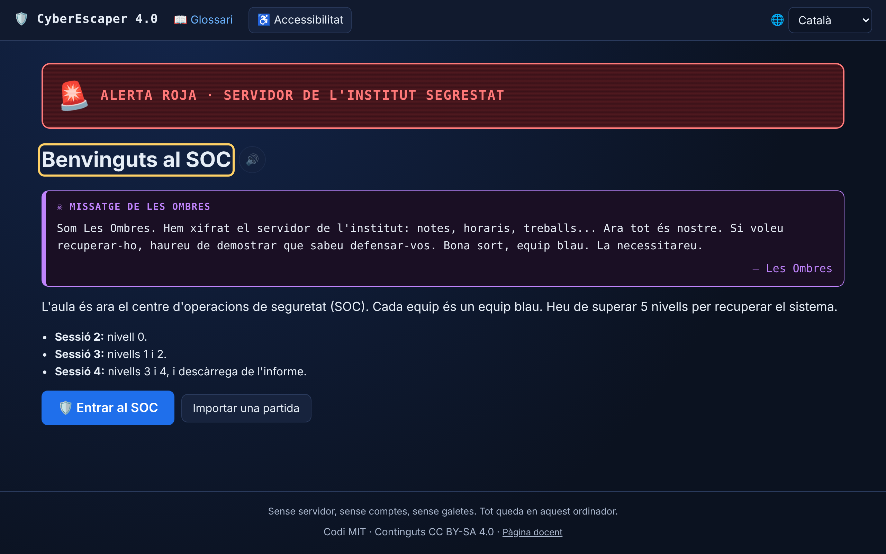
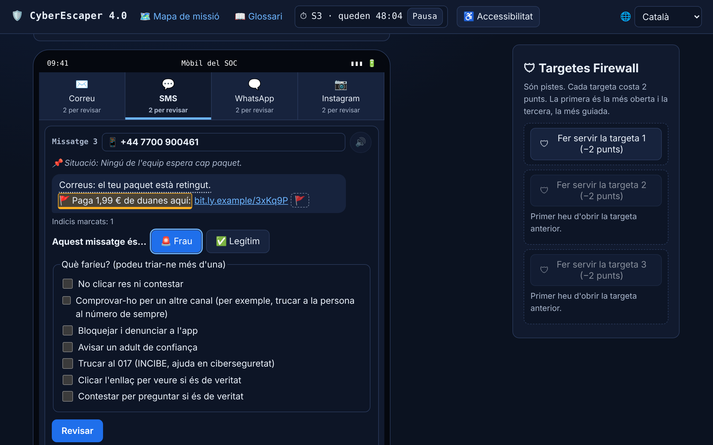
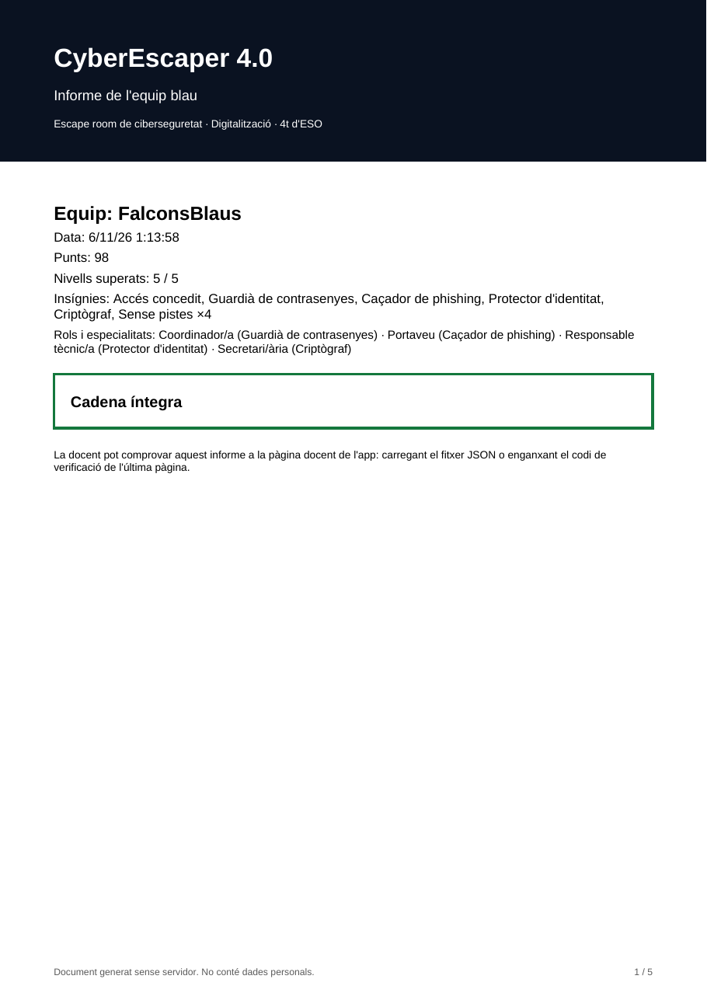

# CyberEscaper 4.0 · Escape room de ciberseguridad

> *Escape room de ciberseguretat per a 4t d'ESO (Digitalització). Català i castellà.*

**▶ Jugar:** https://jpamies.com/cyberescaper/ (también https://jpamies.github.io/cyberescaper/, que redirige)
**Página docente:** https://jpamies.com/cyberescaper/docente.html

CyberEscaper es la webapp de una actividad didáctica para **4.º de ESO, materia Digitalització (Cataluña)**, competencia específica 3 (criterios 3.1, 3.2 y 3.3). El grupo de hackers *Les Ombres* ha secuestrado el servidor del instituto con un ransomware; el aula se convierte en un SOC y cada equipo azul supera 5 niveles para recuperar el sistema:

| Nivel | Título | Contenido | Especialidad |
|---|---|---|---|
| 0 | Auditoria de l'escriptori | Encontrar 8 fallos de seguridad en un escritorio (2 distractores). Da el **código 8** para el nivel 4. | todo el equipo |
| 1 | Contrasenyes | Clasificar 5 contraseñas + crear una frase de contraseña (no se guarda nunca). | Guardián de contraseñas |
| 2 | Caça del phishing | Móvil con 4 canales (correo, SMS, WhatsApp, Instagram), 8 mensajes, 5 fraudes. | Cazador de phishing |
| 3 | Identitat digital i 2FA | Perfil ficticio con 8 datos expuestos + activar la verificación en dos pasos con un TOTP real simulado. | Protector de identidad |
| 4 | Xifratge i cadena de confiança | Cifrado César (desplazamiento 8) con rueda interactiva + manipular una copia de la cadena de hashes. | Criptógrafo |

Cada nivel tiene introducción narrativa, reto, candado, feedback inmediato, 3 **Tarjetas Firewall** (pistas, −2 puntos cada una) e **informe del nivel** obligatorio (mínimo 40 caracteres). No hay ranking ni comparación entre equipos.

| Portada | Nivel 2 (móvil del SOC) | Informe PDF |
|---|---|---|
|  |  |  |

Funciona 100 % en el navegador: HTML, CSS y JavaScript sin framework ni paso de build, servido tal cual por GitHub Pages.

---

## Cómo se usa en clase

Grupo de 25 alumnos en 6 equipos (cinco de 4 y uno de 5), con los ordenadores del centro. Roles fijos: coordinador/a, portaveu, responsable tècnic, secretari/ària.

**Antes de la sesión 2.** Abrir la URL en los ordenadores del centro y comprobar que carga la portada. Proyectar en la pizarra digital con *Accesibilidad → Alto contraste (modo claro)*.

**Sesión 2 (50 min) · Nivel 0.**
1. Portada → «Entrar al SOC».
2. Registro: alias del equipo (3–20 letras o números, **sin nombres reales**), número de miembros y, para cada miembro, rol y especialidad (y como mucho un emoji o una inicial). Deben estar los 4 roles y las 4 especialidades.
3. En el mapa: «Iniciar sesión 2». La cuenta atrás de 50 min es narrativa: si llega a cero no bloquea nada, entra en **prórroga** y resta 5 puntos una sola vez.
4. Nivel 0. Al acabar: «Pausar sesión 2» y **«Descargar el JSON»** (por si el ordenador cambia o se borran los datos).

**Sesión 3 · Niveles 1 y 2.** Si el progreso no está en el ordenador: *Registro → Importar partida* con el JSON. «Iniciar sesión 3». Al final, pausar y descargar el JSON.

**Sesión 4 · Niveles 3 y 4 e informe.** «Iniciar sesión 4». Al acabar el nivel 4 aparece «Sistema restaurado»: descargar **PDF y JSON**, entregarlos a la docente y pulsar **«Tancar i esborrar dades d'aquest ordinador»**.

El progreso se puede descargar en cualquier momento desde el mapa («Descarregar progrés»).

## Cómo se verifica un informe

Cada evento (registro, inicio/pausa de sesión, pista, nivel superado, prórroga, importación, final) es un **bloque** de una cadena:

```
hash = SHA-256(prevHash + JSON canónico del bloque sin el campo "hash")
```

JSON canónico = claves ordenadas alfabéticamente de forma recursiva y sin espacios. El bloque génesis usa `prevHash = "0" × 64`. Si alguien cambia cualquier dato (por ejemplo, los puntos), el hash de ese bloque deja de coincidir y la cadena queda **rota a partir de ese bloque**.

Para verificar: abrir `docente.html` (enlace pequeño en el pie de página) y cargar uno o varios `.json` a la vez, o pegar el **código de verificación** que aparece en la última página del PDF. Para cada equipo se muestra: alias, íntegra/manipulada (y desde qué bloque), niveles, puntos, pistas por nivel y por sesión, tiempo por sesión e informes escritos. El **resumen de grupo** muestra los indicadores del recurso (equipos que completan todos los niveles — meta ≥ 5 de 6 —, pistas por equipo y sesión — meta ≤ 3 — y el nivel con más pistas) y se puede exportar en CSV. La página también incluye la **guía de soluciones** y las pistas de cada nivel. No tiene contraseña: es material para la docente.

El PDF incluye portada (alias, fecha, puntos, insignias y estado «Cadena íntegra» / «Cadena manipulada a partir del bloque N»), tabla de niveles con aciertos, pistas, intentos e informes, tabla de la cadena y el código de verificación (JSON comprimido con `deflate-raw` en base64url), también como QR si cabe.

## Privacidad

Son menores de edad, así que la app está diseñada para **no recoger datos personales**:

- **Qué se guarda:** alias del equipo, rol y especialidad de cada miembro (como mucho un emoji y una inicial), idioma, fechas, pistas usadas, intentos, aciertos y los informes escritos (recortados a 500 caracteres). Un validador con **lista de campos permitidos** rechaza cualquier otro campo, también al importar.
- **Qué no se guarda nunca:** nombres reales, la contraseña creada en el nivel 1 (solo se registra `{longitud, criteriosCumplidos: true}`; vive en memoria mientras la página está abierta), el texto de los mensajes del nivel 2.
- **Dónde:** solo en el navegador, en `localStorage` con el prefijo `cyberescaper:v1:` (caché de la partida, borradores de cada nivel y preferencias). La fuente de verdad es el archivo descargado.
- **Sin** servidor, cuentas, analítica, cookies ni peticiones a dominios externos (todas las librerías están en `vendor/` y hay una Content-Security-Policy que solo permite el propio origen). La página docente procesa los archivos en el navegador: «Els fitxers no surten d'aquest ordinador».
- **Cómo se borra:** pantalla final → «Tancar i esborrar dades d'aquest ordinador» (borra todas las claves `cyberescaper:v1:`), o en el registro «Empezar una partida nueva». También sirve borrar los datos del sitio en el navegador.
- Los informes quedan en la cadena: la app avisa de que no se escriban datos personales.

Todos los datos de los niveles son ficticios. Los enlaces usan dominios reservados (`.example`), nunca navegan y al pulsarlos aparece el aviso «T'hem enxampat!». Los teléfonos son del rango reservado para ficción (+44 7700 900xxx). No se usan logotipos de ninguna marca.

## Ejecutar en local

```bash
python3 -m http.server 8000
```

y abrir http://localhost:8000/. **No funciona con `file://`**: los módulos ES y la carga de las traducciones (`fetch`) no se permiten desde `file://`, y Web Crypto (`crypto.subtle`, necesario para el SHA-256 y el TOTP) solo está disponible en contexto seguro (https o `localhost`).

### Tests

```bash
node --test
```

Sin dependencias (Node 18+). Prueban la cadena (génesis, añadir bloques, verificar, manipulación de cualquier campo en cualquier índice, canonicalización estable, límite de privacidad, exportar/importar), el comprobador de contraseñas (los 5 casos del nivel 1), que todos los `i18n/*.json` tienen las mismas claves (y que existen todas las claves que usa el código) y los datos del nivel 2 (8 mensajes, 2 por canal, 5 fraudes, ningún dominio real).

Hay además una prueba de punta a punta opcional (no se ejecuta en CI) que juega los 5 niveles en Chromium, cambia de idioma, descarga JSON y PDF, borra `localStorage`, importa y verifica en la página docente, y falla si hay errores de consola o peticiones externas:

```bash
NODE_PATH=$(npm root -g) node tools/e2e-playthrough.mjs http://localhost:8000/ ./e2e-out
```

(requiere `playwright` instalado globalmente).

### CI y despliegue

- `.github/workflows/test.yml`: ejecuta `node --test` en cada push y pull request.
- `.github/workflows/pages.yml`: en cada push a `main` ejecuta los tests y, **solo si pasan**, publica en GitHub Pages con `actions/upload-pages-artifact` + `actions/deploy-pages`. En *Settings → Pages* la fuente debe ser **GitHub Actions**.

## Editar contenidos y traducciones

- **Textos:** todos están en `i18n/ca.json` (catalán, por defecto) y `i18n/es.json` (castellano), con las mismas claves. No hay texto de interfaz en el código. `node --test` avisa si falta una clave o si un `{parámetro}` no coincide.
- **Datos y respuestas:** `js/levels/data.js` (niveles 0, 1, 3 y 4) y `js/levels/level2-data.js` (mensajes del nivel 2: canal, si es fraude, qué fragmentos son indicios, enlaces).
- **Puntos, pistas, sesiones:** `js/derive.js` (`LEVEL_POINTS`, `HINT_COST`, `OVERTIME_PENALTY`, `SESSION_SECONDS`).
- **Añadir un idioma:** crear `i18n/<código>.json` con las mismas claves y añadir una línea al array `LANGS` de `js/i18n.js` (hay ejemplos comentados de `en` y `ar`). El CSS usa propiedades lógicas (`margin-inline-start`, `inset-inline-end`...) para que un idioma RTL no obligue a rehacer el diseño. Las frases del cifrado César (`level4.plain`, `level4.reply`) se cifran automáticamente; usad solo letras A–Z.

## Estructura

```
index.html · docente.html
css/       base.css, print.css
js/        app.js (router #/inici, #/equip, #/mapa, #/nivell/0…4, #/final, #/glossari, #/cadena)
           state.js (estado derivado de la cadena + caché localStorage) · chain.js (módulo puro)
           derive.js · codec.js · i18n.js · tts.js · pdf.js · strength.js · totp.js · caesar.js
           timer.js · ui.js · summary.js · chainview.js · docente.js
           levels/ common.js, level0.js … level4.js, data.js, level2-data.js
i18n/      ca.json, es.json
assets/    favicon.svg (las escenas son SVG generados en js/levels/)
vendor/    jspdf.umd.min.js, qrcode.js, LICENSES/
tests/     chain, strength, i18n, level2 (node --test)
tools/     e2e-playthrough.mjs (opcional)
```

## Accesibilidad (DUA)

Selector de idioma visible en todas las pantallas · botón 🔊 en cada pantalla, enunciado, pista y mensaje (Web Speech API en el idioma activo; si el dispositivo no tiene voz para ese idioma, el botón queda desactivado con un aviso) · 3 tamaños de letra (A, A+, A++) · modo claro de alto contraste · efecto máquina de escribir desactivable · respeta `prefers-reduced-motion` · todo usable con teclado (foco visible, pestañas con flechas, rueda de César con flechas, ordenar pasos con botones ↑↓ además de arrastrar) · `aria-live` para candados y feedback · nada depende solo del color (iconos ✔ ✖ 🔒 🚩 y texto) · textos alternativos en las ilustraciones · el temporizador también se muestra como texto y no bloquea nada · glosario con 16 términos en catalán y castellano con pictograma.

## Pendientes conocidos

- **Inglés y árabe**: la estructura está preparada, pero falta traducir y que lo revisen hablantes nativos; el árabe necesita además probar el RTL (no se ha probado en esta versión).
- **Voz en catalán**: muchos Windows/Chromebooks no traen voz catalana; en ese caso el botón 🔊 se desactiva. Se puede instalar una voz catalana en el sistema.
- El PDF usa Helvetica/Courier estándar (WinAnsi): los acentos catalanes y castellanos (à, ç, l·l, ñ...) salen bien, pero los emojis que se escriban en los informes se omiten en el PDF (en el JSON se conservan).
- Si la partida se importa en otro ordenador, se restauran el nivel, los puntos, las insignias y las pistas, pero no el trabajo a medias del nivel en curso (los borradores no forman parte de la cadena).
- El glosario tiene 16 términos (el encargo hablaba de 15, pero listaba 16).

## Licencias

- **Código:** MIT (ver [`LICENSE`](LICENSE)).
- **Contenidos didácticos** (textos, glosario, ilustraciones): [CC BY-SA 4.0](https://creativecommons.org/licenses/by-sa/4.0/deed.es).
- **Librerías de terceros** en `vendor/`: jsPDF 4.2.1 (MIT) y qrcode-generator 1.4.4 (MIT); licencias en [`vendor/LICENSES/`](vendor/LICENSES).
